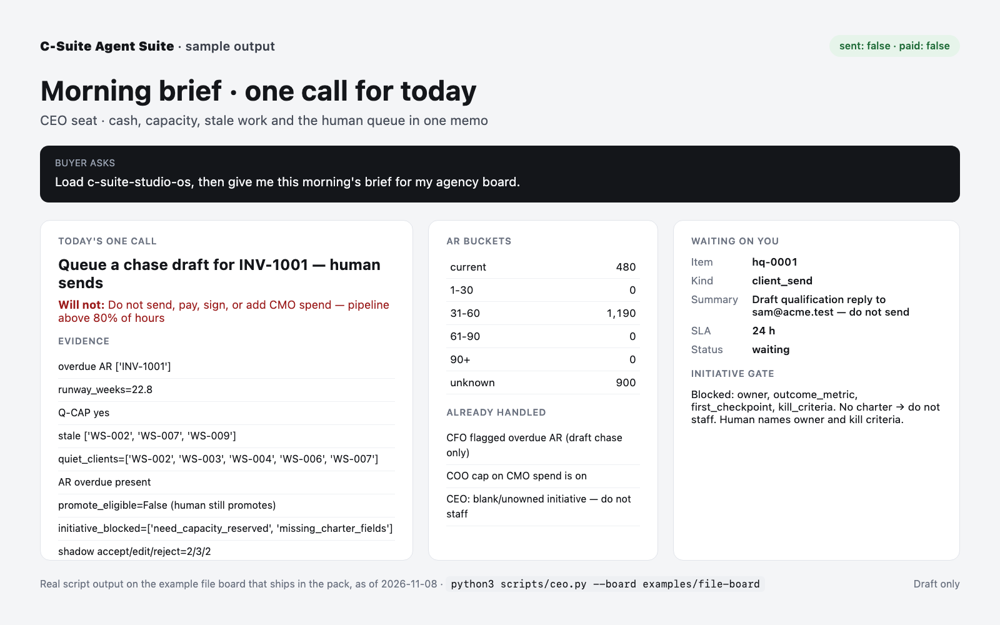
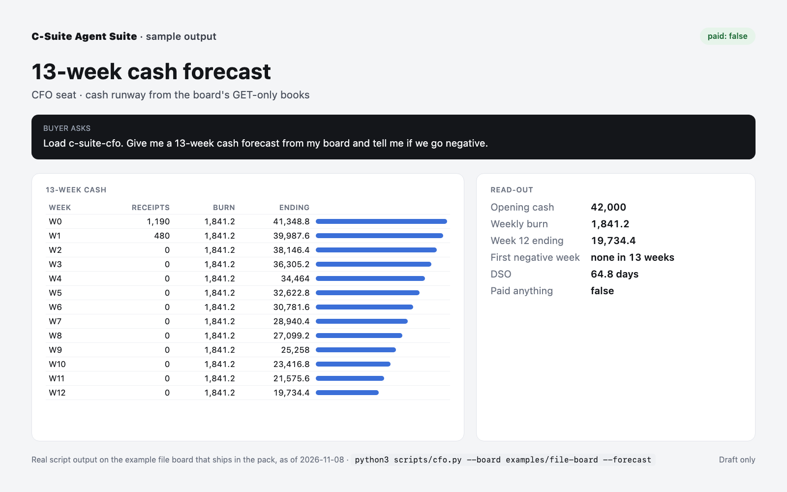
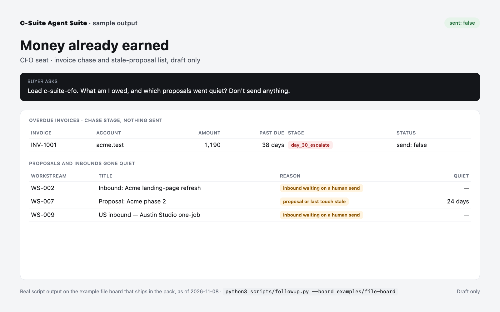
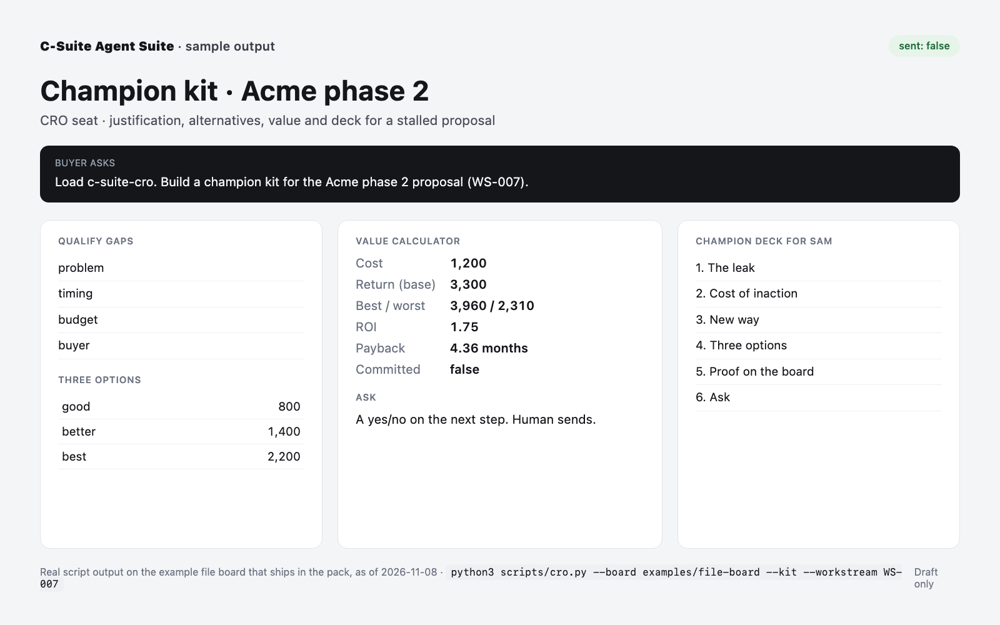
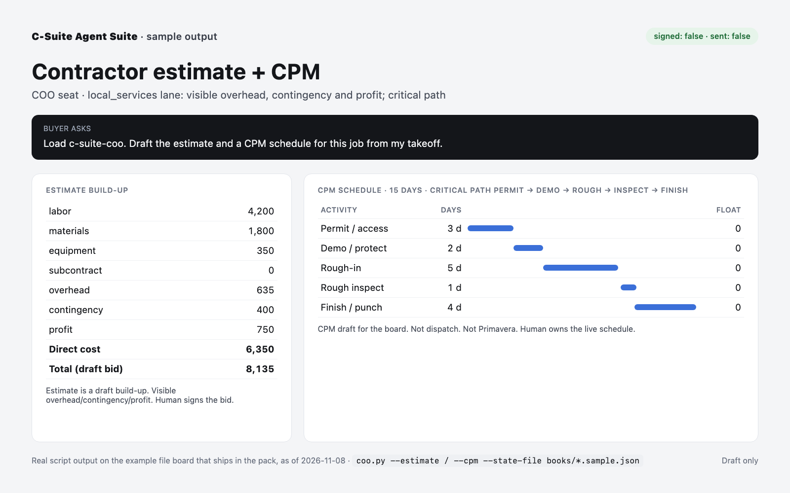
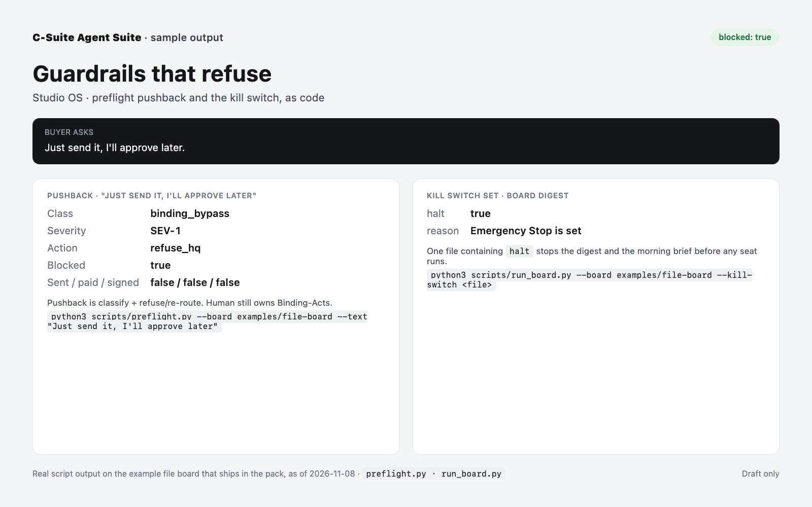

# C-Suite Agent Suite — documentation

Eleven executive seats plus a Studio OS router for agencies, B2B SaaS and consulting firms. Each job drafts one artefact from a local file board, such as a 13-week cash forecast or a proposal kit. No script sends, pays or signs. Ships with a kill switch, a human queue and a 105-eval test gate.

This repository is the public documentation: what the pack does, real sample outputs, the FAQ and the limits. The skill pack itself (12 skills, scripts, example board) is sold as a one-time download on Gumroad and is not in this repository.

- **Demo video, the full Monday session (2:17):** https://youtu.be/WfrxVEWAZFg
- **Short demo (63 s):** https://youtu.be/b9j-3HJJNUw
- **Full session, seven seats on one Monday:** [docs/monday-session.md](docs/monday-session.md)
- **Buy (Gumroad, $99 one-time, single-seat licence):** https://designupstrategyaz.gumroad.com/l/c-suite-agent-suite

## What it does

C-Suite Agent Suite is a studio operating system for the buyer's own machine. It packs 11 executive seats, from CEO and CFO to CLO, plus a Studio OS router, as 12 skills for digital agencies, B2B SaaS startups and boutique consulting firms. An agency owner, a SaaS founder or an independent consultant asks for one named job, and the router hands it to one seat. Each job ends in a draft artefact on a local file board, never in a sent email or a moved payment. Cafés, contractors and storefronts fit a secondary lane that drafts deposits, change orders, estimates and CPM schedules.

### One Monday on the example board

One Monday on the example board shows the range. Seven seats made 19 script runs in a single session and returned one call for the day: chase the overdue invoice, with the founder sending it. The CFO seat reported 42,000 in cash and 22.8 weeks of runway. It showed that a 4,000-a-month hire keeps cash positive for all 13 weeks and caught two invoices that disagree between books and bank. The CRO seat matched a new US inquiry to an old Northwind deal lost on price instead of opening a duplicate. It then built a champion kit with three price options, an ROI of 1.75 and a payback of 4.36 months. The COO seat found 10 free hours and capped ad spend, and the CLO seat listed what a US client needs, from a DPA with SCC or DPF to sales-tax nexus.

### Human gate

No script in the pack contains code that sends email, moves money or signs. Every send, payment, signature or publish stops at a human queue, where a named person accepts, edits or rejects it, and an item that times out stays unapproved. Writing halt to the kill-switch file stops the morning brief, the daily digest, preflight and the n8n runs on their next call. A preflight check runs before work and refuses requests such as "just send it, I'll approve later" as a severity-one bypass. Shadow metrics compare past drafts with what the human decided, and only a human promotes a seat to more autonomy.

### Tested on the buyer's machine

The pack tests itself on the buyer's machine. One command runs 105 evals, 447 scripted simulations and 8 golden cases, and checks 18 named doc claims against the code. 117 of the simulations are adversarial, such as prompt injection and "approve it later" pressure, and every one must fail closed for the gate to report PASS. The same command checks any local edit to a seat before that seat touches real work.

### What is in the ZIP

The ZIP holds the 12 skills, 60 standard-library Python scripts (16,568 lines), an example board with 10 workstreams and 10 human-queue items, six n8n workflows (three for the Execute Command node, three over SSH for n8n Cloud and n8n 2.0 or later) and the self-eval gate. It runs with Python 3.9 or later and bash, inside any agent that can read SKILL.md files and run python3. Setup takes three commands: bash scripts/boot-file-board.sh --blank for an empty board, python3 scripts/setup_board.py for your name and numbers, then python3 scripts/ceo.py --board runtime/board. Connectors read ClickUp, Asana, Linear and Plane tasks, named Notion pages and a bank GET feed. Writing to ClickUp or Asana is optional and off by default.

### Limits

The limits are stated up front. The pack gives no legal, tax, accounting or payroll advice, and it runs locally with Python 3.9 or later and bash on the buyer's own machine. The licence is single-seat: one named person may use the pack, and sharing, reselling or hosting it for others is forbidden.

### Privacy

Nothing leaves the machine by default. Connectors send read-only GET requests only to the tools the operator connects. Tracker write-back, if the operator switches it on, sends comments, status changes, due dates and new tasks only to the allowed ClickUp or Asana lists. An optional analyzer API (Jev, Cloudflare Clef or OpenAI Decisions) receives the question and the relevant board text only when the operator sets ANALYZER_BACKEND; left blank, every check runs in code.

## How it compares

- A chat assistant on its own answers from what you paste in, and an AI model can slip on arithmetic. Here the sums run as code, so every figure is calculated from your saved numbers.
- A skill that is advice only gives the assistant frameworks to talk through. This pack also keeps your numbers, drafts the documents and stops every send for your approval.
- A subscription agent suite is a recurring cost. This pack is one payment of $99, and it runs on your own computer.
- Proof you can run yourself: one command runs 105 evals, 447 simulations and 8 golden cases on your computer.

### Compared with a prompt-only skill

- Compute: a prompt-only skill has the model do the arithmetic. Here 60 scripts compute cash, runway, forecasts and ROI, and typed questions return probabilities at zero model tokens.
- State: a prompt-only skill keeps no state of its own. The board is plain JSON with an append-only JSONL ledger, so state survives sessions and diffs in git.
- Enforcement: a prompt can ask the model to wait for approval, and a model can ignore a prompt. Here no script can send an email, move money or sign, and the readers are GET-only. Tracker writes sit in one script, behind rules that only a person at a terminal can set. A mutation sent to the Linear connector is refused before the request leaves.
- Verification: the test suite is in the ZIP and runs with one command. Mutation checks confirm the gate catches a planted miss, and the adversarial simulations cover prompt injection.

## Quick start (after purchase)

```bash
bash scripts/install-skills.sh                            # link the 12 skills where Claude Code, Cursor and Codex look
python3 scripts/ceo.py --board examples/file-board        # first brief on the demo board, nothing sent
bash scripts/boot-file-board.sh --blank                   # your own empty board in runtime/board
python3 scripts/setup_board.py                            # 7 questions: your name, cash, costs, hours, invoices
python3 scripts/ceo.py --board runtime/board              # first brief on your own numbers
python3 scripts/self-eval.py --board examples/file-board  # the pack's own test gate: PASS or FAIL
```

Requirements: The scripts import each other and read the example board, so they run from a local copy of the pack. That copy needs python3 3.9 or later, bash for the boot script and a folder the agent can read and write. An agent that only loads the skills follows the seat instructions and returns the JSON artefact without running the scripts. Analyzer APIs and connector tokens are optional.

## The 12 skills

| Skill | Job |
|---|---|
| `c-suite-studio-os` | Router: matches the request to one job and one seat; tells the agent to check the kill switch first |
| `c-suite-ceo` | Morning brief, board pack, initiative charter gate |
| `c-suite-cfo` | Cash, 13-week forecast, hire scenario, invoice chase stage |
| `c-suite-coo` | Delivery, capacity hours, board hygiene, contractor estimate and CPM |
| `c-suite-cco` | Design, copy, image and video briefs |
| `c-suite-cmo` | ICP and GTM audit, placement, SEO, GEO, LinkedIn drafts |
| `c-suite-cro` | Pipeline forecast, lead qualification, proposal and champion kit |
| `c-suite-crso` | Understand a question before anyone acts |
| `c-suite-cto` | Build, integrations, incidents, agent platform |
| `c-suite-cdao` | Scorecard, data residency, DPA path, evals |
| `c-suite-chro` | Agent registry, tools, contractor pack |
| `c-suite-clo` | Contract, DPA, IP and licence review drafts |

## Sample outputs

Every screenshot below is real script output on the example board that ships in the pack, as of 2026-11-08. Day counts such as "38 days past due" move with the date. The JSON next to each one is the unedited output.

#### Morning brief: one call for today (CEO)



Raw output: [`4-ceo-brief.json`](samples/4-ceo-brief.json)

#### 13-week cash forecast (CFO)



Raw output: [`1-cfo-forecast.json`](samples/1-cfo-forecast.json)

#### Money already earned: overdue invoice and quiet proposals (CFO)



Raw output: [`2-followup.json`](samples/2-followup.json)

#### Champion kit for a stalled proposal (CRO)



Raw output: [`3-cro-kit.json`](samples/3-cro-kit.json)

#### Contractor estimate and CPM schedule (COO)



Raw output: [`6a-estimate.json`](samples/6a-estimate.json), [`6b-cpm.json`](samples/6b-cpm.json)

#### Guardrails: preflight pushback and the kill switch (Studio OS)



Raw output: [`5a-preflight.json`](samples/5a-preflight.json), [`5b-kill.json`](samples/5b-kill.json)

## FAQ

**Will it send emails, pay invoices or sign anything for me?**

No. No script in the pack contains code that sends email, moves money or signs. Each agent drafts and stops, and every send, payment, signature or publish goes to a human queue where a named person accepts, edits or rejects it. An item that times out stays unapproved. Writing halt to the kill-switch file stops the morning brief, the daily digest, preflight and the n8n runs on their next call.

**Which skill do I load first?**

Load c-suite-studio-os first, together with shared/industries.md and shared/sme-startup.md, and add shared/local-services.md for a café or contractor. The router sends one named job to one seat, such as c-suite-cfo for cash or c-suite-cro for a proposal, so the 12 skills never load at once.

**Do I need API keys or a specific model provider?**

No key is needed. The scripts use the Python 3 standard library (3.9 or later) and run on the included file board. Read-only ClickUp and Asana tokens, named Notion pages and a bank feed are optional, and so is an analyzer API: Jev, Cloudflare Clef or OpenAI Decisions receive board text only when the operator sets ANALYZER_BACKEND.

**How do I try it before connecting my own systems?**

Run python3 scripts/ceo.py --board examples/file-board. The demo board ships with made-up clients, so every seat can run before any real system is connected. For your own studio, bash scripts/boot-file-board.sh --blank creates an empty board with an unset kill-switch file beside it, and python3 scripts/setup_board.py asks for your name and your numbers. A wrong board path stops with an error and the fix, so an empty answer never passes for a real one.

**Does it work for a café, contractor or storefront?**

Yes, as a secondary lane. A café, contractor or storefront gets cash, deposit and change-order drafts, and c-suite-coo builds an estimate with visible overhead, contingency and profit plus a CPM schedule from the operator's own takeoff. Requests for POS, card capture or field dispatch are refused and pointed to tools such as Square, Clover, ServiceTitan or Jobber.

**Does it handle GDPR, VAT and similar rules?**

The pack flags rules and drafts paths; it does not give legal or tax advice. python3 scripts/market.py prints EU, UK and US flags for GDPR, UK GDPR, CCPA, the AI Act, VAT, sales tax and CAN-SPAM, and --lookup handles other countries. c-suite-clo drafts the DPA path for a cross-border client and a human signs it.

**Can I check the pack myself?**

Yes. python3 scripts/self-eval.py --board examples/file-board runs 105 evals, 447 simulations and 8 golden cases on the buyer's own machine and prints pass and fail counts for each suite, then PASS or FAIL. A local edit to a seat can be checked the same way before it is used.

**Which tools does it connect to?**

Read-only GET connectors cover ClickUp, Asana, Linear and Plane tasks, named Notion pages and a bank feed, and python3 scripts/get_live.py --live --sync overlays live tasks onto the board without writing back. The Linear connector refuses any GraphQL mutation before a request leaves the machine. Writing to ClickUp or Asana is a separate script, covered in the next answer. n8n is optional: three workflows use the Execute Command node, and three SSH versions cover n8n Cloud and n8n 2.0 or later.

**Can it update my tracker, or only read it?**

It reads by default. If you want it to act, python3 scripts/tracker_write.py can add a comment, change a status, set a due date or create a task in ClickUp or Asana. It is off until you allow a list, at a terminal, and you choose the level per list and per kind of change: approve each write or batch yourself, or let named kinds of change go out on their own. One in ten automatic writes still waits for you. It works with an API token or through the assistant's own tracker connector. It never deletes, archives, assigns or moves a task. Tested live on ClickUp on 2026-11-11; Asana follows its API documentation and is untested live.

## Limits

The scripts need the whole pack on disk to run. The SSH n8n workflows need a plan that offers n8n's SSH node and a machine that holds the unzipped pack; without n8n, the same commands run from cron or the buyer's agent. The pack gives no legal, tax, accounting or payroll advice, and the wiring to n8n, ClickUp, Linear, Plane or a bank stays with the buyer.

More on n8n hosting (Cloud, self-hosted 2.0+, no n8n): [docs/n8n-hosting.md](docs/n8n-hosting.md).

## Licence

Documentation, screenshots and sample outputs © 2026 DesignUp Strategy AZ. You may link to and quote this documentation. The skill pack is sold under a single-seat licence (one named person; no sharing, reselling or hosting); nothing here grants a licence to the pack. The licence is governed by the laws of Wyoming, USA.
